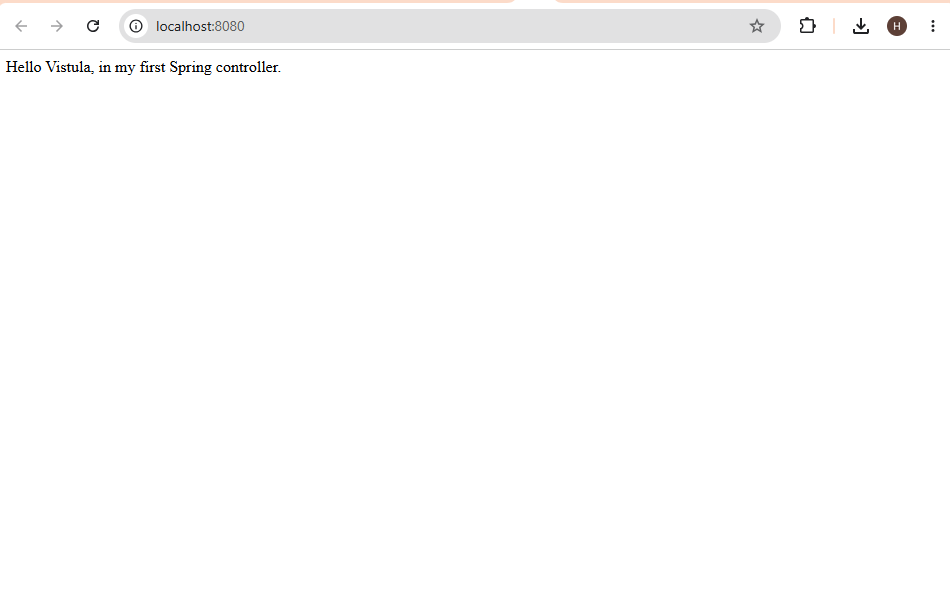
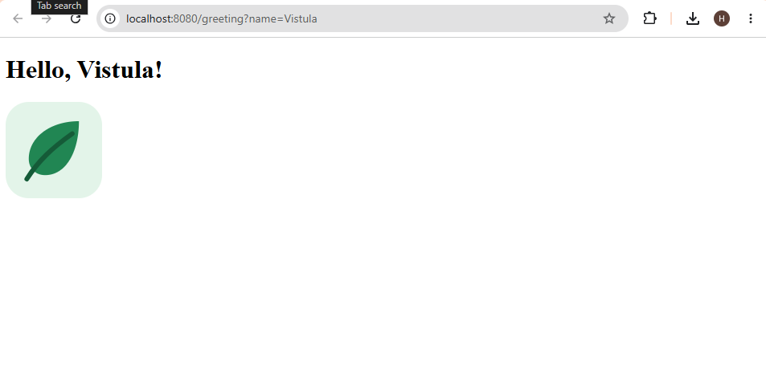

# Task 1 - Spring MVC

In this project I made a simple Spring Boot application.

When I open the main page, I see a text message. I also made a greeting page that shows a name and an image.

## How I run it

1. I open the project in IntelliJ IDEA.
2. I select Java 17 and load the Maven project.
3. I run `Task1Application`.
4. I open http://localhost:8080/ in my browser.

## Main page

The controller returns a message using `@ResponseBody`.

## Greeting page

I open http://localhost:8080/greeting?name=Vistula.

The page shows “Hello, Vistula!” and an image. I can change the name in the address.

